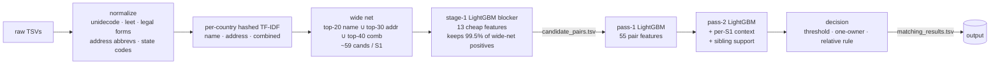

# Business Entity Resolution at 10M-record scale

Matching noisy business records across three sources for the **Amazon ML Challenge 2026**, on a laptop with 7.8 GB RAM.

For every record in a deduplicated reference source (S1), find all records in two other sources (S2, S3) that describe
the same real-world business. That can be zero, one, or many. The records carry typos, leet substitutions, legal-suffix
churn, website-style names, junk names, reordered and truncated addresses, and Indian-script transliterations. The test
set adds a country (**France**) that never appears in training.

| | |
|---|---|
| **Validation macro F0.5** | **0.9589** (precision 0.9877, recall 0.9175) |
| Per country | US 0.9699 · India 0.9424 |
| Blocking | pair recall 0.954 · oracle ceiling 0.9836 · 21.4 candidates / S1 |
| Scale | 1.73M test S1 × 10M S2+S3 pool records, CPU only, peak RSS ≈ 4 GB |
| Model | LightGBM (MIT). No external data, no pretrained models |

All numbers are measured on a held-out validation set of 88,272 train S1 entities (seed 42). See
[`docs/EXPERIMENTS.md`](docs/EXPERIMENTS.md) for the full log.

---

## Problem

* **Data**: `entity_id`, `business_name`, `business_address`, `country` per record. Train covers US + India with
  ground truth (2.2M S1, 10.3M S2+S3). Test covers US + India + France (1.73M S1, 10.0M S2+S3).
* **Metric**: F0.5 computed per S1 entity and macro-averaged, singletons included. An empty prediction on a true
  singleton scores 1.0, and any prediction on it scores 0.0. Precision counts twice as much as recall.
* **Structure found in EDA**: only 5.6% of S1 are singletons, with about 3.5 matches per S1. **No S2/S3 record belongs
  to more than one S1.** 81% of matched S1 have several matches in the *same* source. About 26% of the pool matches
  nothing (distractors).

## Approach



1. **Normalization** (`src/normalize.py`) uses hand-written, country-agnostic rules:
   * unidecode, `&`→`and`, website→name, leet fixes (`Tayl0r`→`taylor`);
   * legal-form extraction covering US, Indian and French forms, plus transliterated `praaivett limittedd`;
   * address abbreviations (`st/rd/av/bd/r…`), state name→code, house numbers, postcodes, and landmark stripping.
2. **Blocking** (`src/blocking.py`) runs per country partition and is sub-quadratic by construction.
   * **Hashed TF-IDF spaces.** Name tokens are words, 4-character prefixes and suffixes, a *consonant skeleton*
     (`tirupati`/`tirupti`→`trpt`), the whole name concatenated, and bigrams. Address tokens are word unigrams and
     bigrams. IDF is fitted unsupervised on the partition.
   * **Chunked top-k search.** Top-k cosine uses S1-chunk × pool-chunk sparse products in parallel worker processes,
     merged with `argpartition`. Tokens with document frequency > 2,000 are excluded from the retrieval product, which
     keeps it sparse.
   * **Learned first-stage blocker.** A 100-tree LightGBM on cheap blocking features prunes the wide net (≈59 → 21
     candidates per S1) while keeping 99.5% of its true pairs. At equal recall, it needs **6 candidates per S1
     instead of the 18 needed with hand-set rank caps**.
3. **Matching** (`src/features.py`, `src/model.py`).
   * 55 features: rapidfuzz name and address similarities, number/postcode/legal-form agreement, fuzzy house-number
     match, skeleton similarity, name/address frequency in the pool, retrieval ranks, and per-S1 context.
   * LightGBM with early stopping on held-out S1 groups.
4. **Stacking** (`src/stack.py`).
   * Pass-1 probabilities are computed out-of-fold on training rows (5 folds grouped by S1).
   * Pass-2 adds per-S1 probability context and **sibling support**, i.e. how similar a candidate is to the S1's most
     confident other candidates. One business's records tend to be near-duplicates of each other.
5. **Decision** (`src/decide.py`) applies a probability threshold plus **one-owner assignment**: each S2/S3 record
   goes only to its best S1, which EDA shows is valid. An optional per-S1 relative rule is included, and everything is
   tuned directly for macro F0.5 on validation.

Country is used **only** as a blocking partition key. It is never a feature, and no code branches on country names,
so France goes through exactly the same path as US and India.

## Results

### Progression (validation, same 88,272 S1)

| Version | Change | Pair recall | Ceiling | Cands/S1 | **F0.5** | P | R |
|---|---|---|---|---|---|---|---|
| v1 | rank-cap blocking + 28 fuzz features | 0.9354 | 0.9769 | 18.45 | 0.9491 | 0.9863 | 0.8932 |
| v2 | + frequency, fuzzy-number, skeleton features | 0.9354 | 0.9769 | 18.45 | 0.9512 | 0.9876 | 0.8983 |
| v3 | wide net + learned stage-1 blocker | 0.9543 | 0.9836 | 21.37 | 0.9558 | 0.9866 | 0.9130 |
| **v5** | **pass-2 stacking (all features + sibling support)** | 0.9543 | 0.9836 | 21.37 | **0.9589** | 0.9877 | 0.9175 |

### Where the remaining points go (v5 loss decomposition, points of macro F0.5)

| Missed by blocking | Matcher false negatives | Matcher false positives | False positives on singletons |
|---|---|---|---|
| 0.0164 (India 0.0104) | 0.0136 | 0.0075 | 0.0036 |

### Negative results (measured, not shipped)

| Idea | Outcome |
|---|---|
| Voiced/unvoiced consonant merge in the skeleton (b/p, d/t, g/k…) | India wide-net recall +0.0001 |
| Unsupervised pool clustering (exact name/address keys) + cluster expansion | permissive rules: 0.915 pairwise precision on the full pool; strict rules: +0.001 recall |
| Second-hop retrieval (use retrieved candidates as queries) | recall India +0.014 / US +0.006 at +3 cands, ceiling only ~+0.002 |
| Split thresholds (first match vs extra matches) | +0.0001 |
| Smaller candidate caps (≤15 per S1, v1 blocking) | −0.003 to −0.015 F0.5 |

Transfer check (leave-one-country-out, v2): train US → India 0.807, train India → US 0.941. Native-script Indian
names are the hard direction. France is Latin-script like US, and on test it gets a match rate similar to the other
countries.

## Repository layout

```
src/                  pipeline (run from the repo root)
  run_pipeline.py     CLI entry point: normalize → block → stage-1 → features → pass-1 → pass-2 → decide → write
  config.py           every parameter, seed = 42
  normalize.py        text normalization (hand-written dictionaries)
  blocking.py         hashed TF-IDF spaces, chunked parallel top-k, stage-1 blocker
  features.py         rapidfuzz pair features + per-S1 context
  stack.py            OOF pass-1, per-S1 probability context, sibling-support features
  model.py            LightGBM training with grouped early stopping
  decide.py           threshold / one-owner / relative rule, macro-F0.5 tuning
  evaluate.py         exact macro F0.5 scorer, blocking recall/ceiling, stage timing + RSS
  io_utils.py         pyarrow TSV reading, output writing
  eda.py              EDA facts used to design the pipeline
scripts/              research probes behind the experiment log (blocking probes, loss decomposition,
                      pool clustering, second-hop retrieval, leave-one-country-out, ...)
notebooks/            Kaggle notebook version of the full pipeline (CPU, 30 GB RAM)
docs/METHODOLOGY.md   full methodology write-up
docs/EXPERIMENTS.md   timestamped experiment log with every measured number
```

## Reproduce

```bash
python -m venv .venv && source .venv/bin/activate      # Windows: .venv\Scripts\activate
pip install -r requirements.txt
# place the challenge data at dataset/train/*.tsv and dataset/test/*.tsv (not included)
python src/run_pipeline.py --data-dir dataset --out-dir output --work-dir work --mode full   # val metrics + test outputs
python src/run_pipeline.py --data-dir dataset --out-dir output_val --work-dir work --mode val # val metrics only
```

* Python 3.10. Tested on Windows 11, 8 cores, 7.8 GB RAM. End-to-end takes about 2–3 h; caches in `work/` make
  re-runs much faster.
* Training and validation use a stratified **subsample** of train S1: 10% train + 4% val per country × has-match.
  That subsample is always blocked against the **full** per-country pool, so distractor density stays realistic. Test
  is processed in full.
* The challenge data and the organisers' validator are not redistributed here.

## Engineering notes

* **Memory.** Blocking and features are processed per country and in S1 chunks, with Arrow-backed column access by
  integer row index and integer-key labels (`pyarrow.compute.index_in`) instead of millions of Python strings.
  Peak RSS stays around 4 GB for 20M+ records.
* **Speed.** Hashing and top-k search run in worker processes. For 810K India test S1 against a 4.7M pool, the
  three-list top-k takes ≈10 min.
* **Reproducibility.** Seeds are fixed and cache keys are versioned (`BLOCK_VERSION`, `FEAT_VERSION`). A clean
  end-to-end re-run of v2 reproduced the submitted files byte for byte.

## License

MIT for the code in this repository. The challenge data belongs to the organisers.
